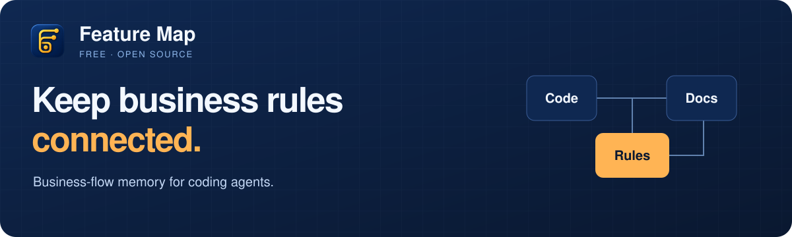

<div align="center">

<picture>
  <source media="(max-width: 600px)" srcset="assets/brand/readme-banner-mobile.svg" />
  
</picture>

# Feature Map

Bantu agent melihat hubungan kode, aturan bisnis, dan dokumentasi saat membuat perubahan.

**[Mulai pakai](#mulai-pakai)** · **[Cara kerja](#cara-kerja)** · **[Panduan lengkap](GUIDE.md#bahasa-indonesia)** · **[Lihat Pro](PRO.md#bahasa-indonesia)** · **[English](README.md)**

File lokal · Bisa direview lewat Git · Claude Code, Codex & Freebuff

</div>

---

## Satu aturan, banyak file

Satu aturan bisa muncul di form, validasi API, halaman admin, dan dokumentasi.
Kalau hanya satu bagian yang diubah, perilaku produk bisa menjadi tidak konsisten.

**Feature Map mencatat hubungan itu di `FEATURE-MAP.yaml`.** Agent mendapat daftar file terkait
beserta aturan yang harus tetap konsisten, lalu memakai alur audit untuk memeriksa perubahan.

| Kebutuhan | Fitur Free |
| :--- | :--- |
| **Pahami alur** | Petakan file dan aturan yang saling terkait, termasuk antar-repo. |
| **Periksa dampak** | Gunakan reminder hook Claude, status flow, dan audit. Codex mengikuti panduan skill serta pemeriksaan CLI. |
| **Siapkan migrasi** | Pindai file aplikasi lama tanpa mengubah source, lalu kumpulkan petunjuk route, UI, auth, dan data. |

Seluruh fitur di repo ini **gratis dan open source dengan lisensi MIT**.

## Mulai pakai

Pilih agent yang digunakan. Semua integrasi memakai registry yang sama, dengan cara setup dan reminder yang berbeda.
CLI dan hook bersama membutuhkan Python 3.

<details>
<summary>Runtime dan kompatibilitas</summary>

Free dan core Free dalam Pro mengikuti format registry serta integrasi agent yang
sama. Perbaikan core dan kompatibilitas tidak dikhususkan untuk edisi berbayar;
pembaruan diambil antar-repo melalui review dan pengujian.

Feature Map Free tidak memerlukan Node untuk menjalankan CLI dan hook. Pro memakai
Node 18.20.8+ untuk installer npm; persyaratan ini tidak membatasi versi Node pada
proyek yang dipetakan. Proyek Node 18 dapat dicatat pada Free maupun Pro.
Pemeriksaan statis berbeda dari menjalankan tes: tes tetap membutuhkan runtime dan
dependency proyek yang sesuai. Persyaratan agent mengikuti masing-masing agent.

</details>

### Claude Code

Pasang plugin:

```bash
claude plugin marketplace add ade-syofyan/feature-map
claude plugin install feature-map@feature-map
```

Di folder project, buat peta lalu periksa hasilnya:

```text
/feature-map:flow-map-init
/feature-map:flow-audit
```

[Panduan command dan hook →](GUIDE.md#penggunaan-claude-code)

### Codex

Clone repo lalu pasang skill:

```bash
git clone https://github.com/ade-syofyan/feature-map.git
cd feature-map
make install-codex
```

Pertahankan folder clone agar CLI bisa memuat modul bersama. Lalu minta Codex:

```text
Gunakan feature-map untuk memetakan flow bisnis project ini, lalu audit peta terhadap kode.
```

[Panduan instalasi dan CLI →](GUIDE.md#penggunaan-codex)

### Freebuff

Ikuti [panduan adapter](freebuff/README.md) untuk setup, reminder perubahan file, dan pemeriksaan sebelum commit.
Sinkronisasi aturan pada adapter ini masih perlu direview dan diterapkan manual.

## Cara kerja

1. **Petakan alur.** Catat file terkait dan aturan yang harus tetap berlaku.
2. **Ubah kode.** Periksa bagian lain dalam alur tersebut. Hook Claude memberi reminder; Codex mengikuti panduan skill.
3. **Review bersama.** Perbaiki bagian yang tertinggal dan perbarui registry jika kontrak bisnis berubah.

Contoh sintetis untuk permintaan ongkir:

```yaml
flows:
  shipping-quote:
    description: "Pelanggan meminta perhitungan ongkir"
    policy: "Tujuan wajib diisi sebelum ongkir dihitung"
    confidence: reviewed
    touchpoints:
      - path: "web/ShippingForm.*"
        role: client-form
      - path: "api/ShippingQuote.*"
        role: backend-validation
      - path: "docs/shipping.md"
        role: docs
    invariants:
      - "Form dan API mewajibkan tujuan sebelum menghitung ongkir"
```

Perubahan gaya statis yang dikenali tidak membuat reminder drift baru pada hook Claude.
Struktur sheet, header, filter, visibilitas, dan format data tetap perlu diperiksa karena bisa mengubah kontrak.
[Batas reminder →](docs/NOTIFICATIONS.md)

## Siapkan migrasi

Pahami aplikasi yang sudah ada sebelum membuat versi baru:

```bash
~/.codex/skills/feature-map/scripts/feature_map_cli.py extract-app /path/to/legacy-app \
  -o /path/to/migration-pack --profile auto
```

Hasilnya berupa `index.md`, `index.json`, dan catatan modul: route, form, filter, petunjuk auth,
struktur data, serta kandidat batas API. Simpan hasil di luar repo aplikasi asal agar folder kerjanya tetap bersih.

Ini pemeriksaan statis. Tool tidak membuka koneksi database, membuktikan seluruh perilaku runtime,
atau otomatis membuat ulang aplikasi. Pemilik project tetap mereview aturan dan hasil temuan.

## Dokumentasi

| Panduan | Isi |
| :--- | :--- |
| [Panduan lengkap](GUIDE.md#bahasa-indonesia) | Command, skema registry, flow antar-repo, dan penanganan masalah. |
| [Pemeriksaan contoh](SMOKE.md) · [Benchmark](BENCHMARK.md) | Bukti pengujian sintetis dan batasnya. |
| [Kontribusi](GUIDE.md#kontribusi) | Contoh, tes, integrasi, dan dokumentasi yang bisa dibantu. |

## Feature Map Pro

**Lanjutkan dari peta alur ke bukti pengujian.** Pro menambahkan pemeriksaan yang bisa dijalankan
pada core Free. Seluruh fitur Free tetap tersedia di repo ini dengan lisensi MIT.

| Kemampuan | Free | Preview Pro |
| :--- | :---: | :---: |
| Registry, audit, dan pemetaan antar-repo | Ada | Ada |
| Import dokumen dan ekstraksi aplikasi | Ada | Ada |
| Cek perubahan antar-branch | — | Ada |
| Tes aturan dan mutasi terpilih | — | Python |
| Simulasi dan perbandingan migrasi | — | Python / command JSON native |
| Reproduksi insiden dan penjaga regresi | — | Runtime yang didukung |

Pro tersedia melalui [installer publik](https://github.com/ade-syofyan/feature-map-installer). Fitur premium memerlukan aktivasi. Skenario native memakai command project dan kontrak JSON yang direview; baca [cakupan fitur](PRO.md#bahasa-indonesia) sebelum membeli.

Untuk harga, pembelian, dan ketersediaan, hubungi **[ade.syofyan@gmail.com](mailto:ade.syofyan@gmail.com?subject=Pembelian%20Feature%20Map%20Pro)**.
[Rincian Pro →](PRO.md#bahasa-indonesia) · Fitur edisi Pro tidak termasuk dalam instalasi Free ini.

---

[English](README.md) · [Panduan lengkap](GUIDE.md#bahasa-indonesia) · [Laporkan masalah](https://github.com/ade-syofyan/feature-map/issues) · [Lisensi MIT](LICENSE)
