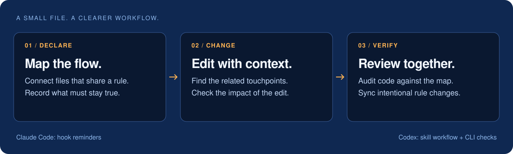

<div align="center">

<picture>
  <source media="(max-width: 600px)" srcset="assets/brand/readme-banner-mobile.svg" />
  
</picture>

# Feature Map

Keep related code, business rules, and documentation in view when your agent makes a change.

[](GUIDE.md#releases)
[](https://github.com/ade-syofyan/feature-map/actions/workflows/test.yml)
[](LICENSE)

**[Get started](#get-started)** · **[How it works](#how-it-works)** · **[Complete guide](GUIDE.md)** · **[Explore Pro](PRO.md)** · **[Bahasa Indonesia](README.id.md)**

Local files · Git-reviewable rules · Claude Code, Codex & Freebuff

</div>

---

<a id="english"></a>

## One rule rarely lives in one file.

A form, an API validator, an admin screen, and a document can all describe the same business rule.
Changing one without reviewing the others can leave the product inconsistent.

**Feature Map records those connections in `FEATURE-MAP.yaml`.** It gives your coding agent a
map of related files and the rules they must share, plus a workflow to review changes together.

| What you need | What Free gives you |
| :--- | :--- |
| **Understand the flow** | A registry of touchpoints and invariants, with links across layers and repos. |
| **Review the impact** | Claude hook reminders, stale-flow tracking, and audits for gaps, drift, and downstream impact. Codex uses the skill workflow and CLI checks. |
| **Plan a migration** | A static, read-only app scan that collects routes, UI, auth, and data clues into a reviewable migration pack. |

All features in this repository are **free and open source under MIT**.

## Get started

Choose your coding agent. Each integration uses the same registry; its reminders and setup differ.
Python 3 is required for the shared CLI and hooks. Use the guide for optional document-import tools.

<details>
<summary>Runtime and compatibility</summary>

Free and the Free core bundled with Pro follow the same registry format and agent
integrations. Core fixes and compatibility improvements are not paid-only features;
updates move between repositories through review and testing.

Free does not require Node to run its CLI or hooks. The Pro npm installer requires
Node 18.20.8+; this does not constrain the Node version of a mapped project. Node 18
projects can be recorded with either edition. Static mapping is separate from test
execution, which requires the project's own runtime and dependencies. Coding-agent
requirements are defined by each agent.

</details>

### Claude Code Usage

Add the marketplace and install the plugin:

```bash
claude plugin marketplace add ade-syofyan/feature-map
claude plugin install feature-map@feature-map
```

Inside your project, create the map and review it:

```text
/feature-map:flow-map-init
/feature-map:flow-audit
```

[Plugin commands and hook setup →](GUIDE.md#claude-code-usage)

### Codex Usage

Clone the repository and install the skill:

```bash
git clone https://github.com/ade-syofyan/feature-map.git
cd feature-map
make install-codex
```

Keep the checkout available. Then ask Codex:

```text
Use feature-map to map this project's business flows, then audit the map against the code.
```

[Verify the installation and explore CLI helpers →](GUIDE.md#codex-usage)

### Freebuff Usage

Use the adapter's [setup guide](freebuff/README.md#-quick-start) for installation,
file-change reminders, and pre-commit checks. Its sync workflow still requires manual review and apply.

## How it works



1. **Map** the files that belong to a business flow and record what must stay true.
2. **Edit** with the related touchpoints in view. Claude hooks provide reminders; Codex follows the skill instructions.
3. **Review** findings, fix gaps, and update the registry when the business contract changes.

Recognized static styling edits do not create new Claude hook drift reminders.
Sheet structure, headers, filters, visibility, and data formats can change a contract and still need review.
[Reminder scope →](docs/NOTIFICATIONS.md)

### Quick Example

A small, synthetic shipping flow:

```yaml
flows:
  shipping-quote:
    description: "Customers request a shipping quote"
    policy: "A destination is required before quoting"
    confidence: reviewed
    touchpoints:
      - path: "web/ShippingForm.*"
        role: client-form
      - path: "api/ShippingQuote.*"
        role: backend-validation
      - path: "docs/shipping.md"
        role: docs
    invariants:
      - "The form and API require a destination before quoting"
```

When one touchpoint changes, the map tells the agent which other files to inspect.
You review the proposed rules; the registry does not infer business truth automatically.

## App Migration Extractor

**Understand an existing app before rebuilding it.** Scan its files without modifying the source:

```bash
~/.codex/skills/feature-map/scripts/feature_map_cli.py extract-app /path/to/legacy-app \
  -o /path/to/migration-pack --profile auto
```

The output includes an `index.md`, structured `index.json`, and module notes covering routes,
forms, filters, auth hints, schema clues, and candidate API boundaries.
Write the pack outside the source repo to keep its working tree untouched.

[Profiles, output structure, and examples →](GUIDE.md#app-migration-extractor)

## Built for review

| Finding | Meaning |
| :--- | :--- |
| `GAP` | A declared touchpoint is missing or incomplete. |
| `DRIFT` | Related implementations or documented rules disagree. |
| `IMPACT` | A related flow may also need attention. |
| `RULE-GAP` | A test description suggests a rule missing from the registry. |
| `OK` | No issue found within the reviewed scope. |

Audits depend on the map, source evidence, and agent review. Static discovery does not prove runtime
behavior, dynamic permissions, or every database relationship. The extractor does not connect to your database
or generate a rewritten app. [Checks and limitations →](BENCHMARK.md)

## Documentation

| Start here | Go deeper |
| :--- | :--- |
| [Complete guide](GUIDE.md) | Commands, registry schema, multi-repo flows, and troubleshooting. |
| [Panduan Indonesia](README.id.md) | Ringkasan produk dan langkah mulai dalam bahasa Indonesia. |
| [Releases](GUIDE.md#releases) | Historical release notes and feature changes. |
| [Smoke checks](SMOKE.md) · [Benchmarks](BENCHMARK.md) | Reproducible synthetic checks and their limits. |
| [Contribute](GUIDE.md#contributing) | Improve examples, tests, integrations, or documentation. |

## Feature Map Pro

**From mapping a flow to checking its behavior.** Pro adds executable checks on top of the Free core.
Existing Free features remain here under MIT.

| Capability | Free | Pro preview |
| :--- | :---: | :---: |
| Flow registry, audits, multi-repo mapping | Included | Included |
| Document import and app migration extraction | Included | Included |
| Parallel branch checks | — | Included |
| Reviewed rule tests and selected mutations | — | Python |
| Simulation and migration comparison | — | Python / native JSON commands |
| Incident reproduction and retained bug guards | — | Supported runtimes |

Pro is distributed through the [public installer](https://github.com/ade-syofyan/feature-map-installer). Premium features require activation. Native scenarios use a reviewed project command and JSON contract; read [scope and availability](PRO.md) before purchase.

For pricing, purchase, and current availability, contact **[ade.syofyan@gmail.com](mailto:ade.syofyan@gmail.com?subject=Feature%20Map%20Pro%20purchase)**.
[Pro details →](PRO.md) · Features in the private Pro edition are not included in this Free installation.

---

<div align="center">

**One flow. Every touchpoint.**

[Report an issue](https://github.com/ade-syofyan/feature-map/issues) · [Read the guide](GUIDE.md) · [MIT License](LICENSE)

</div>
